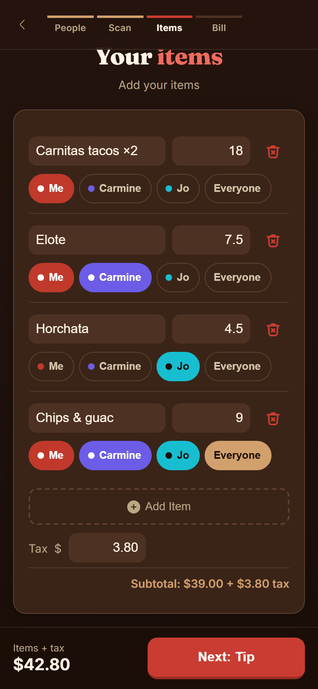
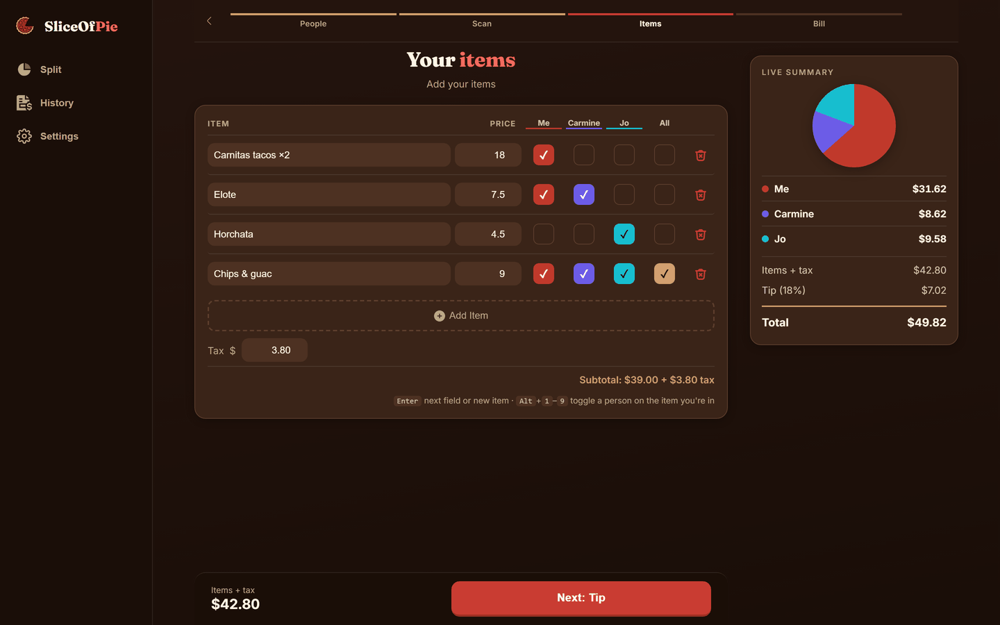

# SliceOfPie

[](https://github.com/hansvidaure24/SliceOfPie/actions/workflows/ci.yml)
[](https://github.com/hansvidaure24/SliceOfPie/releases)
[](LICENSE)

Split bills without the awkward math. Snap a receipt, assign items, add tip, and share who owes what — all offline, all on-device.

**[Live Demo](https://slice-of-pie-xi.vercel.app/)**

<p align="center">
  
</p>

<p align="center">
  &nbsp;&nbsp;
  &nbsp;&nbsp;
  &nbsp;&nbsp;
  
</p>
<p align="center"><sub>Home &bull; Assigning items &bull; Who owes what &bull; Saved bill with paid tracking</sub></p>

<p align="center">
  
</p>
<p align="center"><sub>On a computer: a column per person and a live summary beside the items</sub></p>

## Why

Every bill-splitting app I found either required everyone to sign up, needed an internet connection, or wanted my data. SliceOfPie runs entirely in your browser — no accounts, no backend, no tracking. Install it as a PWA and it works at the restaurant even without signal.

## Features

- **Even or by-item split** — tap people's names under each item (or tick their column on a computer); items nobody is on are flagged before you move on
- **The answer first** — the bill screen opens with what's owed back to you (or your share, if someone else paid), then each person's amount and a pie of the shares
- **OCR receipt scanning** — snap a photo with the in-app camera (guide frame, light and hold-still hints), upload one, drop or paste one on a computer, or share one from your gallery (Android, desktop Chrome). PaddleOCR reads it on-device in a Web Worker and picks out the items (including names that wrap onto a second line and "2 x" quantities), discounts, subtotal, tax, tip, total, merchant and date. A live line shows whether the items match the receipt's total, and a photo that can't be read or doesn't add up offers a retake. In an even split, a scan fills in the total
- **Offline scanner, on your terms** — the scanner (~36 MB) downloads once, after you say yes; Settings shows whether it's ready offline and can download or remove it
- **Tip & tax** — preset tip buttons, custom %, pre-tax or post-tax, round-up toggle; a tip already printed on a scanned receipt is used as-is instead of adding another
- **Bill history** — saved to IndexedDB under a name you choose, track who's paid with one tap; Home lists the bills still unpaid. The app asks the browser to keep it, and Settings exports it to a file and imports it back, for a backup or a new phone
- **Share or copy** — on a computer the bill copies to the clipboard in one click; on a phone it opens the share sheet. Either way your payment details (Venmo, Zelle, Cash App, or your own) are included, and there's a PNG version too
- **Picks up where you left off** — a reload, or the phone dropping the app while you open Venmo, brings you back to the same screen with the bill intact
- **Works like an app** — installable, with home-screen shortcuts (scan, enter a total, who owes me), the system back gesture, and updates that apply themselves (held back with a "new version ready" notice while you're in the middle of a bill)
- **Phone, tablet and desktop layouts** — tabs and a sticky action bar on phones, a live summary beside the steps on tablets, a side rail and a column per person on computers
- **Accessible** — axe finds no WCAG 2.2 AA issues on any screen in either theme; screen-reader announcements, native dialogs, a color-blind-safe person palette, and layouts that hold at 200% text
- **Dark/light theme and currencies** — follows your system or set manually; USD, EUR, GBP, JPY and more
- **Privacy-first** — no server, no analytics, no cookies. Everything stays on your device

## Tech Stack

- **Vite 8** (Rolldown) + **TypeScript 7** (strict mode), no framework
- **vite-plugin-pwa** with `injectManifest` strategy and **Workbox** for precaching, the OCR cache and the share target
- **PaddleOCR.js** (PP-OCRv5 mobile detection + Latin recognition) on **ONNX Runtime Web** (wasm) for client-side OCR, with Tesseract.js 5 as a fallback for browsers that can't run it
- **IndexedDB** for bill history (auto-migrates from localStorage)
- **Vitest** unit tests, a **Playwright** end-to-end suite with **axe-core**, and **Lighthouse CI**, all run by GitHub Actions
- A strict **Content-Security-Policy** (no inline script, no eval on the page)

## Architecture Decisions

**Why vanilla TS instead of React/Vue/Svelte?**
The app is ~4,800 lines across 49 modules. A framework would add a virtual DOM and a state management library to solve problems this app doesn't have. Manual DOM updates via `renderX()` functions mean every state change is explicit and traceable. The result is a small startup bundle (about 22 KB of JavaScript gzipped) and zero framework churn.

**Why a mutable state object instead of a store/signals?**
A single `state.ts` object holds all app state. Each module imports it, mutates directly, and calls the appropriate render function. This works because:
- The app has one user, one screen at a time, no concurrent updates
- Every mutation site is greppable (`state.` across the modules)
- There's no virtual DOM diffing that needs immutability to detect changes

Reactive patterns (signals, proxies, event buses) solve coordination problems that don't exist here. Adding them would be complexity for complexity's sake.

**Why `data-action` instead of `onclick`?**
Buttons say what they do (`data-action="goTo" data-arg="screenHistory"`) and one delegated listener in `actions.ts` runs it. That keeps inline script out of the page, which is what lets it ship a strict Content-Security-Policy. The policies live in `security-headers.json`; `vite preview` serves them, and a test keeps `vercel.json` in step.

**Why is the money math in its own module?**
`bill.ts` has no page dependencies, so who-owes-what (shares, tax and tip, discounts, rounding, people joining and leaving) is unit-tested directly, including a 200-case sweep checking that the shares always add up to the total. Shares are worked out in whole cents: everyone else's is rounded to the nearest cent and whoever paid takes the leftover, so $100 three ways is $33.33, $33.33 and $33.34, and what's owed back always matches the rows.

**Why can every module be loaded in any order?**
There are no import cycles. Screens hook into the router (`onEnterScreen`, `onLeaveScreen`, `setBackRoutes`) instead of the router importing every screen, and lists that are redrawn use `data-action` buttons or one listener on the list rather than a listener per row.

**Why IndexedDB instead of localStorage?**
Bill history can grow to 50 entries with nested people arrays. localStorage has a ~5MB limit and blocks the main thread on read. IndexedDB is async, has no practical size limit, and supports structured cloning. The app auto-migrates existing localStorage data on first load.

**Why CSS mask for icons instead of an icon library?**
SVG files in `public/` are referenced via CSS `mask-image`. This means icons inherit `currentColor` and respond to theme changes automatically — no icon component, no fill props, no sprite sheet. One line of CSS per icon.

**Why does the scanner load late?**
The parser, photo checks, OCR engines and live camera are separate chunks loaded on the first scan, and the stylesheet is inlined into `index.html`, so a visit that never scans downloads none of it. The chunks are still precached, so scanning works offline.

## Testing

```bash
npm test            # Vitest: money math, storage, receipt parsing, updates, backups, headers
npm run build
npm run test:e2e    # Playwright: phone (Pixel 7) and desktop, against the built app
```

- **Unit tests** (`test/`): the money math and its rounding to the cent, starting up with storage blocked, draft resume and its 3-hour expiry, the receipt parser with saved OCR output from real receipts, image quality checks, when a new version is applied, clearing old scanner files from the offline cache, the bills export file (including files that aren't one, or try to sneak in styles), and the security headers.
- **End-to-end tests** (`e2e/`): even and by-item splits with known answers, back navigation and resume, offline use, scanning a drawn receipt online then offline, the share target, axe on every screen in both themes, 200% text, the desktop grid and live summary, drop-to-scan, copy to clipboard, the Content-Security-Policy, a real app update (applied at once on a first visit, held for Reload mid-bill), blocked storage, failed saves, swipe to delete, 16px text fields on touch screens, pinch zoom off only when installed, the tabs and toasts at the bottom of the screen, the live camera (with Chromium's test camera) and a blocked one, the bill as an image, and exporting bills then importing them into a fresh browser. Real receipt photos are gitignored; when they're present in `test/fixtures/receipts/photos/`, a test scans one too.
- **CI** (`.github/workflows/ci.yml`): every push and pull request runs the type check, both suites and Lighthouse; the build fails if performance drops below 90 or accessibility below 100.
- **Before a release**, [docs/device-test-checklist.md](docs/device-test-checklist.md) lists what needs a real phone.

The end-to-end suite runs on Playwright's own Chromium; download it once with `npx playwright install chromium`.

## Getting Started

Needs Node 22.12 or newer.

```bash
npm install
npm run dev
```

Then open `http://localhost:5173` in your browser.

`npm run dev` and `npm run build` first run `scripts/fetch-ocr-assets.mjs`, which downloads the pinned OCR models (~13 MB, SHA-256 checked) into `public/ocr/`. That folder is gitignored.

`npm run bench` opens an OCR benchmark page comparing model sets and Tesseract on synthetic receipt images (see `bench/README.md`).

## Build

```bash
npm run build
npm run preview
```

Output goes to `dist/`. Deploy anywhere that serves static files — a `vercel.json` with the security headers is included if you use Vercel.

## Project Structure

```text
src/
  main.ts          Entry point: start-up, resume, the data-action table
  actions.ts       Delegated data-action listener
  state.ts         Centralized app state and bill totals
  bill.ts          Who owes what, in whole cents; keeping item assignments right as people change
  draft.ts         The bill in progress, kept for 3 hours across reloads
  storage.ts       localStorage that falls back to defaults when the browser blocks it
  router.ts        Which screen shows, the address bar, the system back gesture
  chrome.ts        Top bar, step bar and tabs for each screen
  flow.ts          Moving through a split, and starting a new one
  layout.ts        Wide-screen side panes, drop and paste to scan
  db.ts            IndexedDB wrapper, and asking the browser to keep the data
  backup.ts        Export and import saved bills (Settings)
  backup-format.ts The export file: writing it, and checking one that's imported
  people.ts        People counter, names, contacts, "Add again"
  items.ts         Capture, the item list, running the scan
  assign.ts        Name chips / person columns on each item
  camera.ts        Live camera screen (phones and tablets)
  scanner-status.ts  Download, remove and warm up the offline scanner
  scan/
    process.ts     processReceipt(): image → parsed items
    image.ts       Upright decode and size cap before OCR
    quality.ts     Blur/brightness check (retake prompt)
    live-hints.ts  Camera hints: too dark, hold still, ready
    engine.ts      OcrEngine interface
    engine-paddle.ts     PaddleOCR engine: download, cache, worker client
    paddle.worker.ts     Runs PaddleOCR off the main thread
    paddle-protocol.ts   Messages between the page and the worker
    engine-tesseract.ts  Tesseract.js fallback engine (loaded from the CDN on demand)
    rows.ts        Merge OCR text boxes into receipt lines (tilt-aware)
    parse.ts       OCR lines → items, subtotal, tax, tip, total, merchant, date
    cache-name.ts  Cache names shared with the service worker
    ocr-assets.json      Pinned model files, sizes and hashes
  summary.ts       The bill screen
  tip.ts           Tip presets & custom tip
  pie.ts           Animated pie chart (rAF) with a text alternative
  history.ts       Save, rename, delete, paid tracking, unpaid list
  share.ts         Share / copy text, and which of the two a device leads with
  export-image.ts  Canvas-based PNG export
  payment.ts       Payment method settings
  install.ts       Install prompt, iOS instructions, the one-time nudge
  toggles.ts       Toggle switch handlers
  money.ts         Currencies, rounding and formatting amounts
  dialog.ts        The confirm / prompt sheet (native <dialog>)
  notify.ts        Toasts and screen-reader announcements
  theme.ts         System, light or dark
  colors.ts        Person colors and the text color that reads on each
  helpers.ts       Small DOM helpers
  types.ts         TypeScript interfaces
  sw.ts            Service worker: precache, OCR cache, share target
  update.ts        When a new version of the app takes over
test/              Vitest unit tests and receipt fixtures
e2e/               Playwright end-to-end tests
docs/              README images and the real-device test checklist
scripts/           Fetches the pinned OCR models
bench/             OCR benchmark page
.github/           CI workflow and Dependabot
public/
  *.svg            UI icons (CSS mask technique)
  fonts/           Inter and Fraunces (latin), served with the app
  icon-*.png       PWA icons (192, 512, maskable)
  screenshots/     Shown in the install dialog
security-headers.json  Content-Security-Policy and other headers
```

## Privacy

All data is stored locally on your device using IndexedDB and localStorage, and nothing you enter is sent anywhere. OCR runs entirely in the browser, so your receipt photo never leaves the device. The PaddleOCR model files come from this app's own server. Browsers that can't run PaddleOCR fall back to Tesseract.js, which downloads its code and language data from public CDNs (jsDelivr and projectnaptha.com) the first time it's needed; the photo still stays on the device. See the in-app privacy note in Settings.

## License

[MIT](LICENSE)
