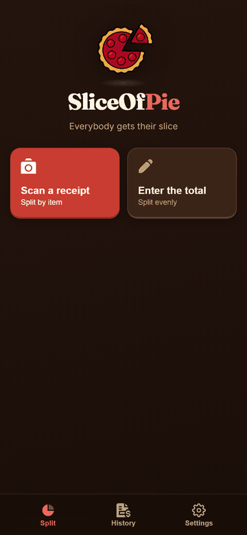
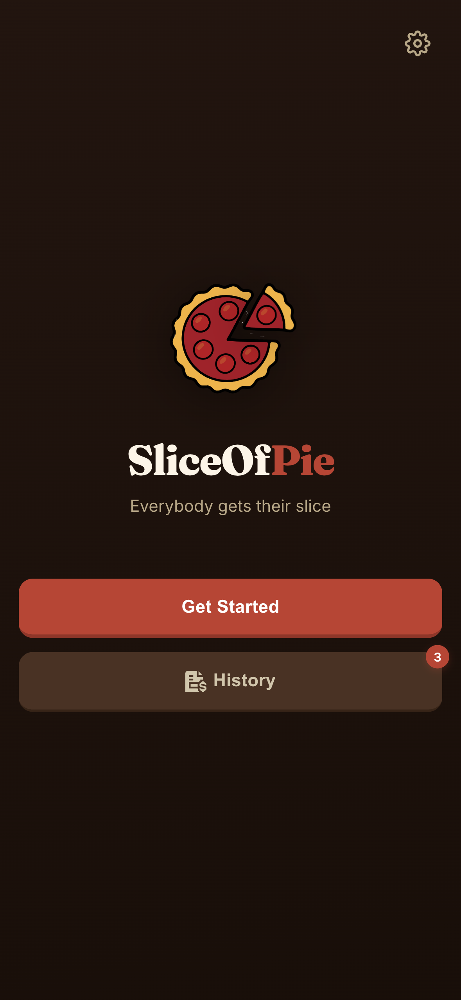
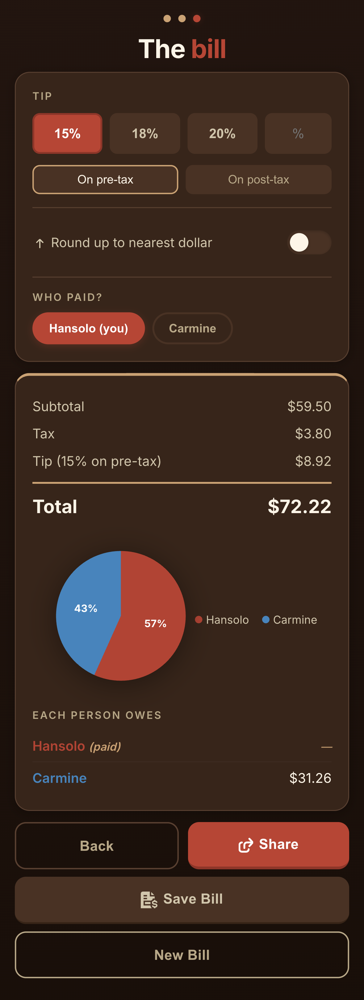
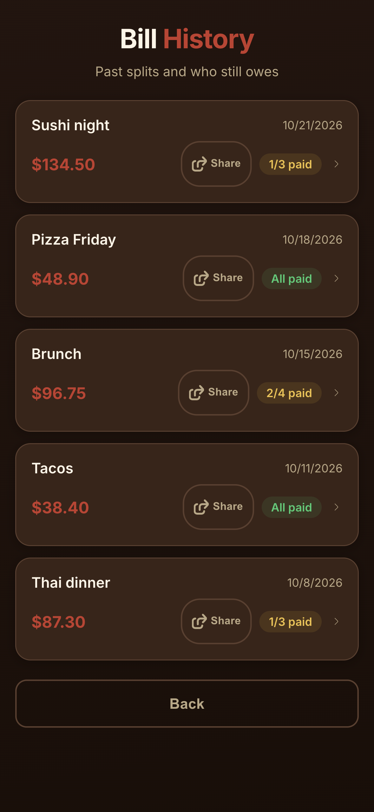

# SliceOfPie

Split bills without the awkward math. Snap a receipt, assign items, add tip, and share who owes what — all offline, all on-device.

**[Live Demo](https://slice-of-pie-xi.vercel.app/)**

<p align="center">
  
</p>

<p align="center">
  &nbsp;&nbsp;
  &nbsp;&nbsp;
  
</p>
<p align="center"><sub>Welcome &bull; Summary with pie chart &bull; Bill history with paid tracking</sub></p>

## Why

Every bill-splitting app I found either required everyone to sign up, needed an internet connection, or wanted my data. SliceOfPie runs entirely in your browser — no accounts, no backend, no tracking. Install it as a PWA and it works at the restaurant even without signal.

## Features

- **Even or by-item split** — assign items to specific people or split the total evenly
- **OCR receipt scanning** — snap a photo or upload an image, Tesseract.js extracts line items on-device
- **Tip & tax** — preset tip buttons, custom %, pre-tax or post-tax, round-up toggle
- **Bill history** — saved to IndexedDB, track who's paid with one tap
- **Share** — native share sheet or clipboard, includes your payment details
- **Payment settings** — Venmo, Zelle, Cash App, or custom method included in shared text
- **Installable PWA** — works offline, add to home screen on any device
- **Privacy-first** — no server, no analytics, no cookies. Everything stays on your device

## Tech Stack

- **Vite 5** + **TypeScript** (strict mode)
- **vite-plugin-pwa** with `injectManifest` strategy
- **Workbox** for precaching and offline support
- **Tesseract.js 5** for client-side OCR
- **IndexedDB** for bill history (auto-migrates from localStorage)
- No runtime dependencies beyond Tesseract.js (loaded from CDN)

## Getting Started

```bash
npm install
npm run dev
```

Open `http://localhost:5173` in your browser.

## Build

```bash
npm run build
npm run preview
```

Output goes to `dist/`. Deploy anywhere that serves static files — a `vercel.json` is included if you use Vercel.

## Project Structure

```text
src/
  main.ts        Entry point, event wiring
  state.ts       Centralized app state
  db.ts          IndexedDB wrapper
  people.ts      People counter & name inputs
  items.ts       OCR parsing & item list
  assign.ts      Item-to-person assignment
  summary.ts     Bill calculation & breakdown
  tip.ts         Tip presets & custom tip
  pie.ts         Animated pie chart
  history.ts     Save/load/delete bills
  share.ts       Share text generation
  payment.ts     Payment method settings
  navigation.ts  Screen transitions
  toggles.ts     Toggle switch handlers
  helpers.ts     Utilities (fmt, esc, toast)
  types.ts       TypeScript interfaces
  sw.ts          Service worker (Workbox precache)
public/
  *.svg          UI icons (CSS mask technique)
  icon-*.png     PWA icons (192, 512)
```

## Privacy

All data is stored locally on your device using IndexedDB and localStorage. Nothing is sent to any server. OCR runs entirely in the browser via Tesseract.js. See the in-app privacy note in Settings.

## License

[MIT](LICENSE)
